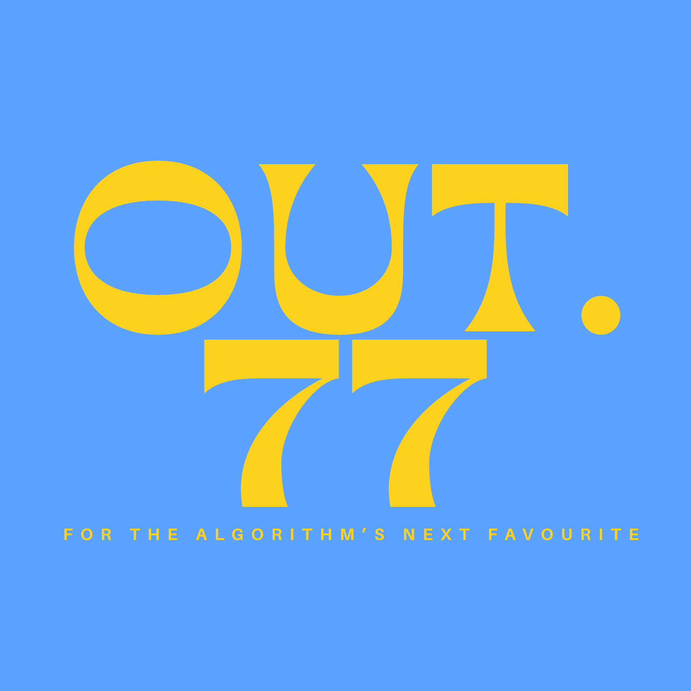
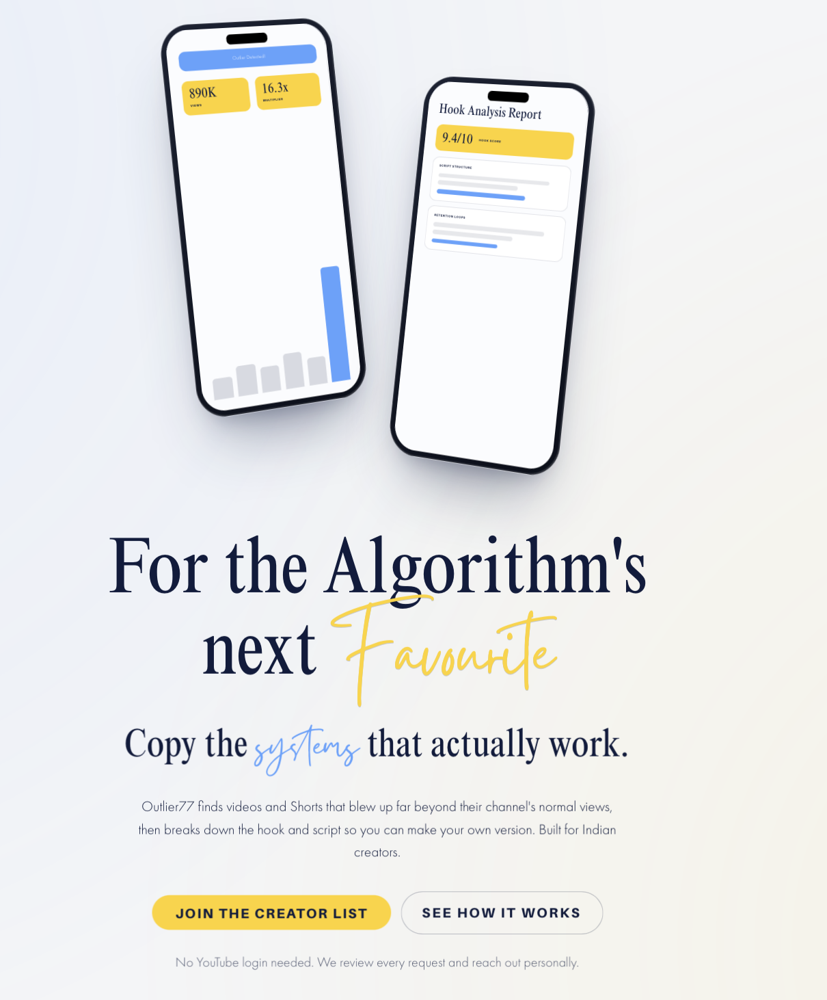
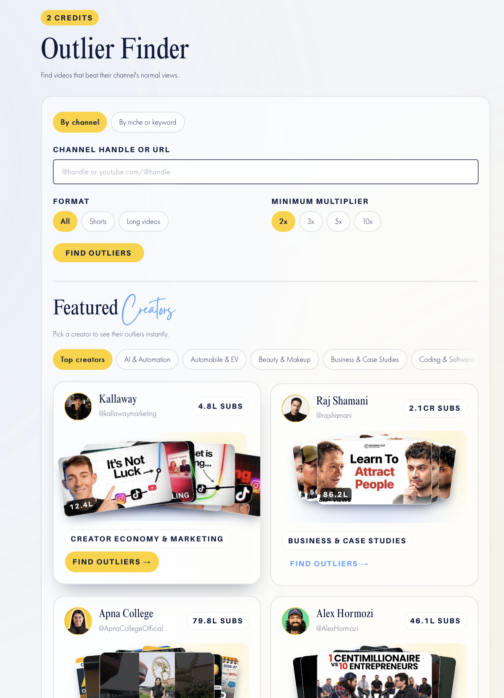
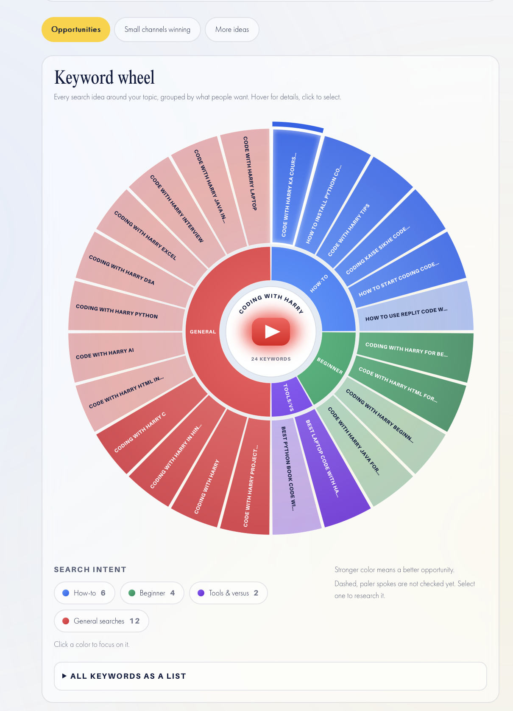
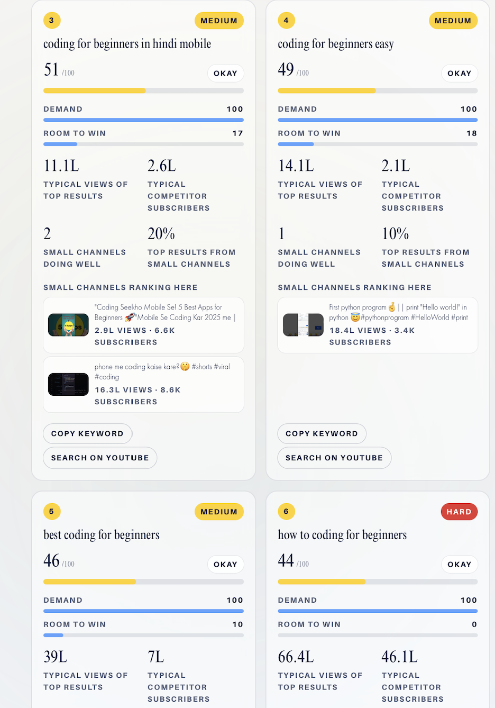
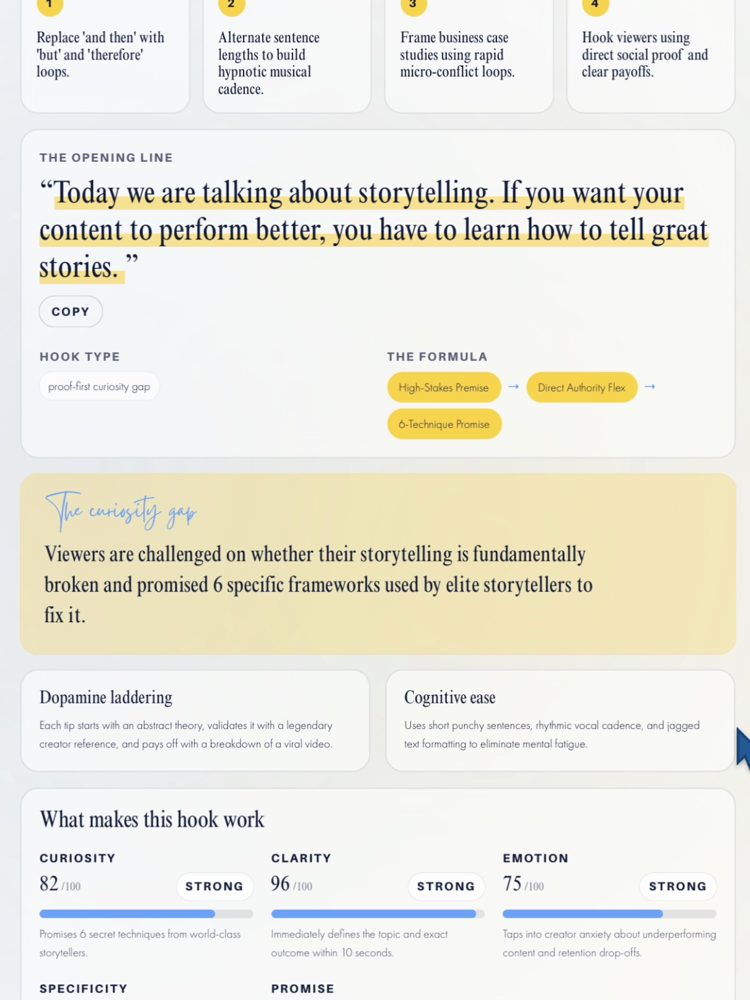
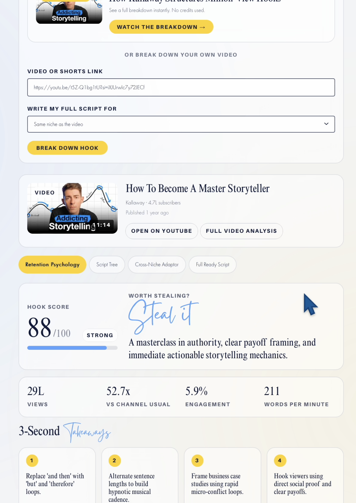
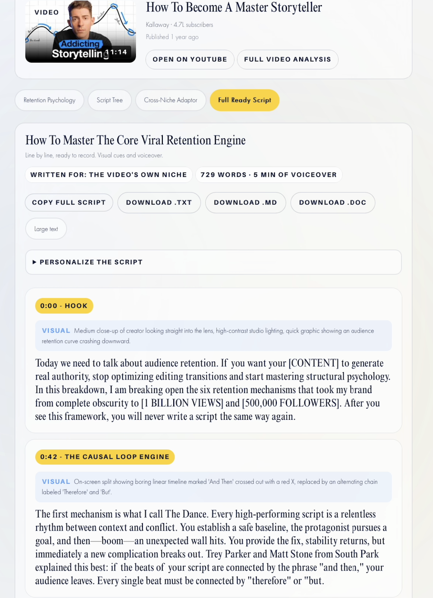

# Outlier77 - *For the Algorithm's Next Favourite*

---

## Table of Contents

1. [Brand Identity & Visual Philosophy](#1-brand-identity--visual-philosophy)
2. [Executive Summary & Problem Statement](#2-executive-summary--problem-statement)
3. [The Psychological Growth & Exclusivity Funnel](#3-the-psychological-growth--exclusivity-funnel)
4. [Complete Repository Architecture & Directory Mapping](#4-complete-repository-architecture--directory-mapping)
5. [Backend & Utility Layer (`/lib`) Specification](#5-backend--utility-layer-lib-specification)
6. [Hybrid AI Engine Architecture & Pipeline](#6-hybrid-ai-engine-architecture--pipeline)
7. [YouTube Data API v3 Quota Optimization Strategy](#7-youtube-data-api-v3-quota-optimization-strategy)
8. [Comprehensive Feature & Interface Showcase](#8-comprehensive-feature--interface-showcase)
   - [8.1 Landing Page & Conversion Funnel](#81-landing-page--conversion-funnel)
   - [8.2 Outlier Finder Engine](#82-outlier-finder-engine)
   - [8.3 Keyword Intelligence & Radial Search Wheel](#83-keyword-intelligence--radial-search-wheel)
   - [8.4 Keyword Opportunities & Data Cards](#84-keyword-opportunities--data-cards)
   - [8.5 Hook Analysis & Retention Psychology Engine](#85-hook-analysis--retention-psychology-engine)
   - [8.6 Storytelling Mechanics & Framework Analysis](#86-storytelling-mechanics--framework-analysis)
   - [8.7 Editorial Script & Production Engine](#87-editorial-script--production-engine)
9. [Credit Economy & Transaction Verification](#9-credit-economy--transaction-verification)
10. [Database Security & Row-Level Access (Supabase)](#10-database-security--row-level-access-supabase)
11. [Comprehensive Technical Stack](#11-comprehensive-technical-stack)

---

## 1. Brand Identity & Visual Philosophy

Outlier77 is built as a high-end intelligence asset for content creators, growth agencies, and strategists. Rather than adopting standard commercial SaaS visual trends, Outlier77 uses a refined aesthetic featuring custom serif typography, electric blue and yellow contrast accents, structured card layouts, and strict visual hierarchy.

<div align="center">
  
</div>

The visual language communicates authority, mathematical precision, and strategic depth. Every component—from the high-contrast performance badges to the interactive radial search wheel—is designed to highlight actionable data over raw noise.

---

## 2. Executive Summary & Problem Statement

### The Problem in Creator Analytics
Traditional social analytics platforms treat content creators as novices trying to reach baseline monetization thresholds. Conventional tools display raw metrics—such as total view counts or total subscriber figures—without providing context on *why* a video performed exceptionally well. Creators are left guessing why certain videos achieve massive reach while others stall. Furthermore, public commodity pricing models diminish perceived software value by turning strategic insights into cheap, transactional commodities.

### The Outlier77 Solution
Outlier77 solves this by isolating statistical anomalies (outliers) across YouTube channels, breaking down high-retention video script structures, and revealing high-demand, low-competition search gaps. Operating behind an invite-only waitlist model, Outlier77 provides high-ticket creators and agencies with an exclusive content intelligence dashboard.

---

## 3. The Psychological Growth & Exclusivity Funnel

The platform deliberately avoids public pricing tables, opting instead for a five-stage psychological conversion funnel designed to build curiosity and demand:

1. **Stage 1: Landing Page (The Hook & Curiosity):** Performance multipliers and script retention analysis are presented without upfront price tags. Visitors evaluate the product as an exclusive intelligence asset rather than comparing it to low-cost subscription tools.
2. **Stage 2: Micro-Commitment Waitlist:** A simple waitlist form collects initial user data and immediately triggers a high-value PDF guide via email, establishing instant value and goodwill.
3. **Stage 3: VIP Approval & Access:** Direct invitation communications elevate user status, providing a secure magic link for seamless single-click login.
4. **Stage 4: Dashboard Entry & Endowment Effect:** Approved users receive trial credits to immediately test tools against their own channel and niche data, building fast product adoption.
5. **Stage 5: Credit Exhaustion & Monetization:** Pay-as-you-go credit top-ups are introduced when trial credits run out, making payments feel like buying essential production fuel rather than taking on recurring software overhead.

---

## 4. Complete Repository Architecture & Directory Mapping

The codebase follows a modern Next.js 15 App Router structure with modular separation between application routes, reusable components, content dictionaries, and backend logic:

```
Outlier77/
├── .cursor/                 # IDE rules and Cursor AI configuration files
├── .next/                   # Next.js build output directory
├── app/                     # Next.js 15 App Router pages and API route handlers
│   ├── (auth)/              # Authentication routing (Login, Magic Link callbacks)
│   ├── (dashboard)/         # Protected dashboard workspace and tool pages
│   │   ├── channel/         # Channel Analysis tool
│   │   ├── hooks/           # Hook & Script Breakdown tool
│   │   ├── keywords/        # Keyword Research & Search Wheel
│   │   ├── monetization/    # Monetization Tracker & Calculator
│   │   ├── outliers/        # Outlier Finder tool
│   │   ├── resonance/       # Idea Resonance Check tool
│   │   └── video/           # Video & Shorts Analyzer tool
│   ├── api/                 # API endpoints (Razorpay webhooks, AI endpoints)
│   ├── favicon.ico          # Platform favicon
│   ├── globals.css          # Global CSS, custom utility classes, font variables
│   ├── layout.tsx           # Root layout shell
│   └── page.tsx             # Public landing page entry
├── components/              # Modular UI components
│   ├── dashboard/           # Sidebar, header credit badge, dashboard navigation
│   ├── landing/             # Hero, phone mockups, waitlist form, FAQ accordion
│   ├── tools/               # Reusable analysis cards, score indicators, action blocks
│   └── ui/                  # Base UI components (Buttons, Modals, Inputs, Badges)
├── content/                 # Site copy, copy.ts dictionary, text definitions
├── design/                  # Design tokens, color specifications, asset guidelines
├── docs/                    # Briefs, sample API responses, and specifications
├── lib/                     # Backend domain logic, API wrappers, utility handlers
├── node_modules/            # Installed project dependencies
├── public/                  # Static media, public brand assets, and logos
├── supabase/                # Supabase database migrations, schemas, RLS policies
├── .env.local               # Environment variables (API keys, secrets)
├── .gitignore               # Git untracked files specification
├── AGENTS.md                # AI agent instructions and repository rules
├── CLAUDE.md                # System prompt rules and engineering standards
├── eslint.config.mjs        # ESLint code quality rules
├── next.config.ts           # Next.js configuration and route rewrites
├── package.json             # Manifest file with dependencies and scripts
├── postcss.config.mjs       # PostCSS styling configuration
└── tsconfig.json            # TypeScript compiler configuration
```

---

## 5. Backend & Utility Layer (`/lib`) Specification

The backend infrastructure relies on specialized TypeScript utility modules located in the `/lib` directory, ensuring isolated domain logic:

* **`lib/api-client.ts`:** Unified client-side fetch wrapper handling error propagation, headers, and request timeouts.
* **`lib/credits.ts`:** Governs user credit balances, consumption rules, and deduction validation across all dashboard tools.
* **`lib/exportScript.ts`:** Document compiler providing multi-format script downloads (`.txt`, `.md`, `.doc`).
* **`lib/featured.ts`:** Manages curated creator profiles, category presets, and channel metrics for featured showcase grids.
* **`lib/format.ts`:** Formats numerical outputs into clean regional scales (Thousands `K`, Lakhs `L`, Millions `M`, Crores `Cr`).
* **`lib/hookAnalyzer.ts`:** Deconstructs video transcripts into structural hooks, open loops, and psychological pacing triggers.
* **`lib/keywordTools.ts`:** Evaluates demand, calculates "Room to Win" metrics, and clusters search intent keywords into categories.
* **`lib/llm.ts`:** Centralized AI orchestration engine managing prompt formatting and payload delivery across Google Gemini and Anthropic Claude.
* **`lib/monetization.ts`:** Calculates YouTube Partner Program eligibility baselines, watch-hour approximations, and target timelines.
* **`lib/outlier.ts`:** Computes historical channel view baselines and detects statistical performance multipliers.
* **`lib/razorpay.ts`:** Handles payment order generation, cryptographic signature verification, and webhook transaction processing.
* **`lib/readAI.ts`:** Ingests raw video transcripts, timestamps, and public metadata.
* **`lib/supabase.ts`:** Initializes authenticated Supabase database clients with Row-Level Security (RLS) policies.
* **`lib/types.ts`:** Centralized TypeScript definitions and API contract interfaces.
* **`lib/youtube.ts`:** Optimized YouTube Data API v3 wrapper handling quota-efficient data fetches.

---

## 6. Hybrid AI Engine Architecture & Pipeline

Outlier77 uses a dual-engine AI routing system to balance processing speed with high-quality copy generation:

```
                           [ Incoming User Request ]
                                      │
                         ┌────────────┴────────────┐
                         ▼                         ▼
            [ High-Speed Data Tools ]   [ High-End Editorial Tools ]
                         │                         │
                         ▼                         ▼
               Google Gemini Flash         Claude 3.5 Sonnet / Gemini Pro
               (~0.05s / Low Cost)         (Human-Grade Script Optimization)
                         │                         │
                         └────────────┬────────────┘
                                      ▼
                        [ Structured JSON Output ]
```

### Routing Strategy:

* **Google Gemini Flash (`lib/llm.ts`):** Handles high-volume data processing tasks where speed and context length are critical. It parses YouTube transcripts, indexes timestamps, calculates keyword intent clusters, and extracts video metrics.
* **Anthropic Claude 3.5 Sonnet (`lib/hookAnalyzer.ts`):** Powers the Hook & Script Breakdown engines. It evaluates emotional hooks, maps retention mechanisms (such as open loops and pattern interrupts), and writes production-ready video scripts tailored to specific niches.

---

## 7. YouTube Data API v3 Quota Optimization Strategy

YouTube Data API v3 imposes a default quota limit of 10,000 units per day. To prevent quota exhaustion during heavy search operations, `lib/youtube.ts` uses a strict caching and batching strategy:

1. **Statistical Sampling over Full Traversal:** Instead of fetching every video from a channel, `lib/outlier.ts` queries a statistically significant sample of recent uploads to calculate baseline performance.
2. **Batch Channel Requests:** Multi-channel lookups combine multiple channel IDs into a single `channels?part=snippet,statistics` API call, reducing quota cost from 100 units per lookup to 1 unit per batch.
3. **Transcript Extraction Bypass (`lib/readAI.ts`):** Transcript data is fetched directly via public caption tracks rather than consuming YouTube API quota points.
4. **Supabase Caching Layer:** Processed channel baselines, keyword search results, and transcript breakdowns are cached in Supabase. Subsequent requests for identical channels or keywords serve cached results instantly with zero API quota consumption.

---

## 8. Comprehensive Feature & Interface Showcase

### 8.1 Landing Page & Conversion Funnel
The public landing page sets the platform tone, using clean typography and subtle phone frame mockups to demonstrate value without showing upfront pricing tables.

<div align="center">
  
</div>

* **Hero Interface:** Presents headline copy (*"For the algorithm's next favourite"*) and sub-headline messaging focused on reverse-engineering proven viral structures for Indian creators.
* **Dual Action CTAs:** Primary CTA (*"Join the creator list"*) opens the waitlist modal, while secondary CTA (*"See how it works"*) smooth-scrolls to feature explanations.
* **Visual Mockups:** Interactive mobile frames showcase automated outlier detection alerts (`890K Views`, `16.3x Multiplier`) alongside structured hook reports (`9.4/10 Hook Score`).

---

### 8.2 Outlier Finder Engine
The Outlier Finder identifies videos and Shorts that have performed significantly above a channel's normal view baseline.

<div align="center">
  
</div>

* **Header Credit Badge:** Displays real-time credit costs (`2 CREDITS`) for running an outlier search.
* **Search Modes:** Toggle between searching **By channel** handle (`@handle`) or **By niche or keyword** topic.
* **Format & Threshold Filters:** Filter outputs by format (**All**, **Shorts**, **Long videos**) and set performance thresholds (**2x**, **3x**, **5x**, **10x** minimum view multipliers).
* **Featured Creators Grid:** Quick-access preset cards featuring top creators across categories (e.g., *Kallaway*, *Raj Shamani*, *Apna College*, *Alex Hormozi*), displaying subscriber counts, category tags, and one-click outlier lookup buttons.

---

### 8.3 Keyword Intelligence & Radial Search Wheel
The Keyword Research tool maps YouTube search demand and competition using an interactive radial search wheel (`lib/keywordTools.ts`).

<div align="center">
  
</div>

* **Radial Keyword Wheel:** Displays search terms grouped radially around a core topic (e.g., *CODING WITH HARRY*).
* **Intent Color Coding:** Keywords are categorized by intent:
  * **Blue (How-to):** Practical, tutorial-based searches.
  * **Green (Beginner):** Introductory and foundational concepts.
  * **Purple (Tools & Versus):** Software, comparisons, and equipment queries.
  * **Red (General Searches):** Broader search queries.
* **Opportunity Indicators:** Radial spoke opacity indicates opportunity level—solid spokes mark evaluated high-opportunity keywords, while pale/dashed spokes highlight unqueried terms ready for analysis.

---

### 8.4 Keyword Opportunities & Data Cards
For targeted search phrases, the platform generates detailed opportunity cards that break down competition metrics and small-channel performance.

<div align="center">
  
</div>

* **Opportunity Score:** Evaluates keywords on a 1–100 scale (e.g., `51/100 OKAY`, `49/100 OKAY`, `44/100 HARD`) combining demand volume and small-channel success rates.
* **Demand vs. Room to Win Bars:**
  * **Demand Bar (0–100):** Estimates search interest based on top-result view counts.
  * **Room to Win Bar (0–100):** Measures how easily smaller channels can rank in top search positions.
* **Competitor Metrics:** Displays typical view averages (e.g., `11.1L Typical Views`, `14.1L Typical Views`) alongside average competitor subscriber counts (`2.6L Subscribers`).
* **Small Channels Ranking Here:** Highlights smaller channels succeeding in this topic (e.g., a channel with `6.6K Subscribers` pulling `2.9L Views`), proving the search gap is open to new creators.

---

### 8.5 Hook Analysis & Retention Psychology Engine
The Hook Breakdown tool dissects top-performing video intros layer-by-layer, identifying key engagement triggers and psychological pacing techniques.

<div align="center">
  
</div>

* **The Opening Line Analysis:** Isolates the exact introductory statement and categorizes the underlying hook formula (e.g., *High-Stakes Premise → Direct Authority Flex → 6-Technique Promise*).
* **Curiosity Gap Assessment:** Highlights how the intro creates unanswered tension to keep viewers watching.
* **Cognitive Mechanics:** Evaluates *Dopamine Laddering* and *Cognitive Ease*, showing how sentence pacing prevents audience drop-off.
* **Psychological Dimension Scoring:** Evaluates script performance across five core dimensions:
  * **Curiosity (82/100 STRONG):** Evaluates the strength of unanswered questions raised in the intro.
  * **Clarity (96/100 STRONG):** Measures how quickly the main value proposition is explained.
  * **Emotion (75/100 STRONG):** Assesses viewer emotional triggers.

---

### 8.6 Storytelling Mechanics & Framework Analysis
Analyzes macro storytelling structure, evaluating performance against channel baselines and breaking down key retention drivers.

<div align="center">
  
</div>

* **Performance Metric Strip:** Displays overall video performance metrics—total views (`29L`), performance multiplier (`52.7x vs Channel Usual`), engagement rate (`5.9%`), and pacing (`211 Words Per Minute`).
* **Hook Score & Steal Verdict:** Evaluates overall hook strength (`88/100 STRONG`) with an executive verdict badge (`Steal it`).
* **3-Second Takeaway Cards:** Highlights actionable structural lessons:
  1. *Replace "and then" with "but" and "therefore" loops.*
  2. *Alternate sentence lengths to build hypnotic musical cadence.*
  3. *Frame business case studies using rapid micro-conflict loops.*
  4. *Hook viewers using direct social proof and clear payoffs.*

---

### 8.7 Editorial Script & Production Engine
Transforms breakdown insights into teleprompter-ready scripts formatted with visual cues and voiceover lines tailored to the user's specific niche.

<div align="center">
  
</div>

* **Script Header & Metadata:** Displays script target niche, calculated word count (`729 Words`), and estimated voiceover runtime (`5 Min of Voiceover`).
* **Multi-Format Export Options:** Allows one-click script exports in multiple formats: **Copy Full Script**, **Download .TXT**, **Download .MD**, and **Download .DOC**.
* **Timestamped Production Blocks:** Formats script segments with timestamp markers (e.g., `0:00 - HOOK`, `0:42 - THE CAUSAL LOOP ENGINE`), providing explicit **VISUAL** cues alongside corresponding **VOICEOVER** text.

---

## 9. Credit Economy & Transaction Verification

Application tools are tied to a credit ledger managed by `lib/credits.ts`. Credit balances are tracked per user and deducted upon request execution:

| Feature / Tool Module | Credit Cost | Cost Rationale |
| :--- | :--- | :--- |
| **Monetization Calculator** | `0 Credits` (FREE) | Free tool to drive user onboarding and retention |
| **Outlier Finder** | `2 Credits` | High-speed Gemini data fetch and calculation |
| **Keyword Intelligence** | `2 Credits` | Search volume aggregation and intent wheel rendering |
| **Video & Shorts Analyzer** | `5 Credits` | Detailed transcript parsing and metric evaluations |
| **Channel Analysis** | `5 Credits` | Deep channel-wide historical analysis |
| **Idea Resonance Check** | `10 Credits` | Cross-niche format compatibility evaluation |
| **Hook & Script Breakdown** | `20 Credits` | Comprehensive Claude 3.5 Sonnet script generation |

### Razorpay Payment Flow (`lib/razorpay.ts`):
1. **Order Creation:** When a user triggers an upgrade, `lib/razorpay.ts` creates a checkout order via the Razorpay API.
2. **Client Checkout Modal:** Opens the native Razorpay payment overlay supporting UPI, Google Pay, Net Banking, and Cards.
3. **Cryptographic Webhook Verification:** Upon payment completion, Razorpay dispatches a signed webhook payload to Next.js API routes.
4. **Signature Validation:** The server verifies HMAC SHA256 signatures before updating the user's credit balance in Supabase.

---

## 10. Database Security & Row-Level Access (Supabase)

Data persistence and user permissions are managed via Supabase PostgreSQL instances (`lib/supabase.ts`):

* **Row Level Security (RLS):** All database tables (such as `profiles`, `credit_transactions`, `saved_breakdowns`) enforce strict RLS policies. Users can only read and write their own data records.
* **Authentication:** Passwordless Magic Link and Google OAuth flows eliminate password vulnerabilities and simplify login.
* **Real-time Credit Sync:** UI header badges subscribe to PostgreSQL table changes, instantly updating credit counts following deductions or Razorpay top-ups.

---

## 11. Comprehensive Technical Stack

* **Frontend Framework:** Next.js 15 (App Router), TypeScript, React 19
* **Styling & Design System:** Tailwind CSS, Lucide Icons, Custom Serif/Handwritten Font Typography
* **Database & Auth:** Supabase (PostgreSQL, Row Level Security, Realtime Subscriptions, Auth)
* **AI Provider Engines:** Anthropic Claude 3.5 Sonnet SDK, Google Gemini 2.0 Flash / 1.5 Pro SDK
* **External APIs:** YouTube Data API v3
* **Payment Processing:** Razorpay Gateway SDK & Cryptographic Webhooks
* **Deployment & Infrastructure:** Vercel Platform

---
*Note: Core application source code, proprietary system prompts, and production API keys remain in a private repository to protect intellectual property.*
